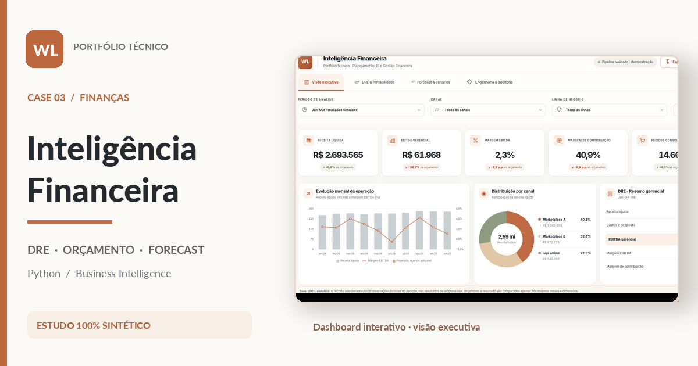

# Case 03 | Inteligência de Negócios e Gestão Financeira · V3 · Design minimalista terracota

**Portfólio técnico de Wanderson Limas**  
**Python · ETL · Modelagem financeira · DRE gerencial · Orçamento vs realizado · Forecast · Business Intelligence · HTML/CSS/JavaScript**

> **Case 03 publicado no GitHub Pages.** Estudo técnico demonstrativo com dados 100% sintéticos. A página pública apresenta o dashboard interativo, enquanto o repositório reúne código-fonte, documentação, testes e materiais de apoio.



[**▶ Abrir dashboard interativo**](https://wandersonlimas.github.io/portfolio-inteligencia-financeira-bi/) · [**Abrir dashboard local**](index.html) · [**Ver prévia da interface**](entregaveis/Preview_Case03.png) · [**Ler relatório executivo**](entregaveis/Relatorio_Executivo_Case03_Gestao_Financeira.pdf)

### Versão V3: interface minimalista com identidade financeira própria

Nesta revisão, a interface foi reconstruída para seguir o layout aprovado, sem o cabeçalho gigante anterior. A navegação, os filtros e os cinco KPIs ficam imediatamente acessíveis. O layout foi atualizado com tons de **terracota, areia e branco**, distinto dos cases anteriores. São cinco cards individuais, evolução mensal combinando receita e margem, gráfico de rosca por canal e DRE executiva. Os mesmos filtros continuam alimentando todos os painéis. O PDF e a miniatura seguem a identidade. [Veja a revisão visual.](docs/EVOLUCAO_VISUAL_V3.md)

## O que o estudo demonstra

Simula a análise financeira de uma operação digital multicanal, partindo de dados gerados por código, até um dashboard executivo e um relatório com rastreabilidade de fórmulas. O objetivo é discutir **rentabilidade, estrutura de custos e cenários de decisão**, não reproduzir qualquer atividade empresarial real.

**Acesse localmente:** abra [`index.html`](index.html) no Chrome, Edge, Firefox ou Safari. Não precisa de servidor, API, chave, banco de dados ou internet. Todo o CSS, JS e JSON necessário está embutido no HTML gerado.

### Visões

- **Visão executiva:** receita líquida, EBITDA operacional simplificado, margens, pedidos, orçamento e diagnósticos por regras.
- **DRE & rentabilidade:** demonstrativo detalhado, ponto de equilíbrio gerencial, análise por canal e linha, série mensal.
- **Forecast & cenários:** simulações conservadora, base e otimista; parâmetros de receita e custos variáveis somente para nov-dez/2026.
- **Engenharia & auditoria:** pipeline, fórmulas, controles, rejeições e limites de interpretação.

**Filtros globais:** período, canal e linha. **Exportação CSV:** recorte da DRE em centavos inteiros, abrangendo todos os registros filtrados. Não depende de bibliotecas externas.

## A base sintética e o corte temporal

Todos os valores são inventados com gerador pseudoaleatório `seed=20261108`.

- Janeiro–outubro de 2026: **realizado simulado** (observações fictícias, sem relação com um empregador ou negócio).
- Novembro–dezembro de 2026: **estimativa simulada** (média Ago–Out por canal/linha multiplicada por sazonalidade explícita).
- Janeiro–dezembro de 2026: **orçamento fictício** para comparação.

**Importante:** não existe resultado real, receita verificada, desempenho de cliente, cálculo contábil auditado, aplicação de IA generativa nem benefício financeiro comprovado neste case.

## Resultado da simulação

| KPI jan-out/2026 | Valor demonstrativo |
|---|---:|
| Receita líquida | R$ 2.693.565,05 |
| EBITDA gerencial | R$ 61.967,62 |
| Margem EBITDA | 2,3% |
| EBITDA orçado (jan-out) | R$ 94.237,18 |
| Desvio de EBITDA | -R$ 32.269,56 |
| Registros válidos / rejeitados | 90 / 3 |

O caso simula receita acima do orçamento e rentabilidade aquém da meta, exigindo análise de CMV, taxas, logística e despesas fixas. Essa é uma **situação hipotética**, não uma experiência profissional relatada.

## Estrutura de arquivos

```text
.
├── index.html                    # HTML autocontido, pronto para GitHub Pages
├── README.md
├── METODOLOGIA.md
├── requirements.txt
├── .gitignore
├── codigo/
│   ├── gerar_dados.py            # fontes fictícias e erros deliberados
│   ├── pipeline.py               # validação, DRE, rateio, orçamento, forecast
│   ├── gerar_dashboard.py        # empacota CSS/JS/JSON em HTML
│   ├── gerar_relatorio.py        # PDF executivo baseado no pipeline
│   ├── gerar_miniatura.py        # miniatura a partir de captura real
│   └── executar.py               # execução integral
├── dados/
│   ├── brutos/                  # CSVs fictícios por fonte
│   └── processados/             # modelo JSON, DRE por mês e quarentena
├── src/web/                     # HTML, CSS e JS editáveis
├── testes/test_pipeline.py      # validações automatizadas
├── docs/
│   ├── ARQUITETURA.md
│   └── PUBLICACAO_GITHUB_LINKEDIN.md
└── entregaveis/
    ├── dashboard_offline.html
    ├── Relatorio_Executivo_Case03_Gestao_Financeira.pdf
    ├── Preview_Case03.png
    ├── Preview_Mobile_Case03.png
    └── Miniatura_LinkedIn_Case03.png
```

## Reproduzir

Requer Python 3.10+. ReportLab gera o PDF e Pillow permite recriar a miniatura a partir de uma captura real do dashboard.

```bash
python -m pip install -r requirements.txt
python codigo/executar.py
python -m unittest discover -s testes -v
```

O comando recria os dados com seed fixa, recompila o pipeline, atualiza `index.html` e refaz o relatório em PDF. A miniatura pode ser regenerada após atualizar `entregaveis/Preview_Case03.png` com uma captura real, usando `python codigo/gerar_miniatura.py`. A análise monetária trabalha com **centavos inteiros**, sem ponto flutuante para somas de dinheiro. A interface também trabalha em centavos. Os cenários usam arredondamento por linha.

## Documentação

- [Metodologia, dicionário e fórmulas](METODOLOGIA.md)
- [Arquitetura técnica](docs/ARQUITETURA.md)
- [Implementação visual V3 (terracota)](docs/EVOLUCAO_VISUAL_V3.md)
- [Histórico de evolução V2](docs/EVOLUCAO_VISUAL_V2.md)
- [Verificação de qualidade V3](docs/QA_V3.md)
- [Publicação no GitHub e LinkedIn](docs/PUBLICACAO_GITHUB_LINKEDIN.md)
- [Relatório executivo PDF](entregaveis/Relatorio_Executivo_Case03_Gestao_Financeira.pdf)

## Transparência

Este material não reproduz dados, marcas, clientes, estratégias ou código pertencentes a empresas reais. As demonstrações e indicadores não são contábeis, gerenciais reais ou projeções de um empreendimento existente. O EBITDA é aproximação operacional didática e as despesas fixas são rateadas por receita apenas para habilitar recortes na interface.
